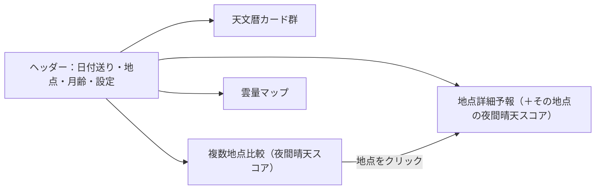

# AstroWeather 要件定義（v3 ドラフト）

ChatGPTとの会話ログ3本（Open-Meteo概要／既存サービス・地図・ホスティング検討／予報の信頼性・雲量マップ検討）から要件を抽出・整理したもの。
ChatGPTの調査結果は、2026-10-08に一次情報（公式ドキュメント・実際のAPIレスポンス）で検証し、修正を反映した（付録A）。

> **v2（2026-10-29）**：光害・月を混ぜた撮影スコアを廃止し、「判断材料を並べる統合天文情報ダッシュボード」にした。
> **v3（2026-10-29）**：**気象予報だけ**を使う「夜間晴天スコア」を導入し、複数地点比較を復活させた。光害・月はスコアに入れない。変更点は付録B・Cを参照。

---

## 1. コンセプト

**天体撮影・観望の判断材料を1画面に集めた、統合天文情報ダッシュボード。最終判断はユーザーが行う。**

- 表示するのは、互いに独立した次の情報
  1. **天文暦**：太陽・月の出入り／南中、月齢、天文薄明、暗夜（月明かりのない完全な夜）の時間帯
  2. **登録地点の詳細予報**：複数の数値予報モデルの雲量・気象要素を、加工せずにモデル別で並べる
  3. **夜間晴天スコア**：天文薄明終了〜翌朝の天文薄明開始の間の**予報だけ**を0〜100点にしたもの。複数地点比較に使う
  4. **雲量マップ**：雲の面的な分布と時間変化
- 光害・月明かりは**スコアに入れない**。月は天文暦カードで別に見せ、光害は扱わない（ユーザーが地点ごとに把握している前提）
- 想定エリア：**日本全国**（作者の主な利用地は北海道。例：芦別・当別・支笏湖・美瑛・幌加内・ニセコ）
  - 主力モデルのMSMは日本と朝鮮半島を範囲にしていて、国内全域で使える
  - 初期表示の地図範囲は日本全体にする

### 設計原則
- **情報の独立性**：天文暦・予報・スコア・雲量マップは、それぞれ単独で意味が通るカード／パネルとして表示する。**天文要素（月・光害）と気象要素を掛け合わせた合成指標は作らない**
- **スコアは気象だけ**：スコアに使う天文情報は「どの時間帯を集計するか（天文薄明の外側）」の区切りだけ。中身は雲・降水などの予報値のみ
- **スコアは中身を見せる**：スコアの横に、モデル別の点数・時間ごとの晴れ具合・連続して晴れる時間帯を必ず並べ、なぜその点なのかが分かるようにする
- **詳細予報は無加工**：地点詳細の予報グラフは、モデルが出した値をそのまま見せる
- **事実としての計算はOK**：「暗夜＝天文薄明の外側かつ月が地平線下」のように、定義が明確な天文計算は表示する

### 既存サービスとの関係

| サービス | 足りない点 |
|---|---|
| SCW | 雲量マップは優秀だが、天文暦や複数モデルの地点予報が別画面・別サービス |
| Clear Outside | 地点別予報は良いが、どのモデルの予報か不透明（Meteosource統合） |
| Weatherian / Alpine Conditions 等（Open-Meteo利用） | モデル比較はできるが、天文暦（薄明・月・暗夜）が一緒に見られず、日本向けの地点比較もない |

→ **天文暦ダッシュボード ＋ モデル別の地点予報 ＋ 夜間晴天スコアによる複数地点比較 ＋ 雲量マップ** を1つのアプリに統合する。

---

## 2. 機能要件

### 2.0 画面構成

- ヘッダーで選んだ**日付と地点**が、全パネル共通のコンテキストになる（日付を送ると天文暦・予報・マップの時刻がすべて連動）
- PCでは横並び、スマホでは縦スクロールのカード表示を基本とする

### 2.1 ヘッダー（共通コンテキスト）
- **日付表示と前後送り**：`‹ 2026年10月29日 木曜日 ›`（ローカルタイム、`Asia/Tokyo`）
- **地点表示**：地点名（または「現在地」）＋緯度経度（例：`43.08°N, 141.35°E`）
  - 地点の切替：現在地（Geolocation API）／登録地点の一覧から選択
- **月齢バッジ**：月相アイコン（輝面比・欠け方向を反映した描画）＋月齢（小数1桁、例：`18.1`）
  - 月齢の基準時刻は、その日の正午（または表示中の夜の中央）に統一する
- **設定ボタン**（⚙）：地点管理、表示するモデル、単位など

### 2.2 天文暦ダッシュボード（必須）
添付イメージのレイアウトを基本とする。すべてブラウザ側で計算する（API不要）。

#### (a) 太陽カード
| 項目 | 表示例 |
|---|---|
| 日の出 | 6:04 |
| 南中（高度） | 11:18 (33.5°) |
| 日の入 | 16:31 |

- 対象日（暦日）の現象を表示する
- 出入りの定義：太陽上縁が地平線に接する時刻（大気差34′・視半径16′を考慮、高度 −0.833°）

#### (b) 月カード
| 項目 | 表示例 |
|---|---|
| 月の出 | 18:21 |
| 南中（高度） | 翌 2:39 (74.5°) |
| 月の入 | 翌 10:56 |

- 「その日の夜」に関係する現象を出すため、**対象日の正午以降に最初に起こる**月の出・南中・月の入を表示する
- 翌日にまたがる時刻には「**翌**」を付ける
- 該当する現象が24時間内に無い場合は「—（なし）」と表示する
- 出入りの定義：月上縁、大気差考慮（視差・視半径は計算ライブラリの標準に従う）

#### (c) 天文薄明カード
| | 朝の薄明開始 | 夕の薄明終了 |
|---|---|---|
| 今日 10月29日(木) | 4:29 | 18:06 |
| 明日 10月30日(金) | 4:30 | 18:05 |

- 天文薄明＝太陽高度 −18°
- 今日・明日の2日分を表示する
- 高緯度・夏至付近で太陽が −18° まで沈まない日は「終夜薄明」と表示する（北海道でも6月前後に起こりうる）
- 将来：航海薄明（−12°）・常用薄明（−6°）の切替表示

#### (d) 暗夜カード
「その日の夜」（対象日の夕方 〜 翌朝）のうち、**天文薄明の外側（太陽高度 < −18°）かつ月が地平線下**の時間帯を暗夜とする。

- 表示内容
  - 対象の夜：`10/29〜30 の夜`
  - 合計時間：`計 14分`
  - 区間の列挙：`18:06 薄明終了 → 18:21 月の出`（区間の始まりと終わりの理由も表示する）
  - **タイムラインバー**：夕の薄明終了 〜 翌朝の薄明開始を横軸にし、暗夜（紫）と月明かり（黄土色）を塗り分ける。両端に時刻を表示（`18:06` 〜 `翌4:30`）
- 暗夜区間は1夜に**複数**ありうる（例：宵の暗夜 → 月の出 → … / 月の入 → 明け方の暗夜）。すべて列挙する
- 「月明かり」は月が地平線上にある、という事実の表示にとどめる。月の明るさ（月齢・高度）による**重み付けや良し悪しの評価はしない**
- 暗夜が0分の夜は「暗夜なし」と表示する

#### 天文計算の実装方針
- ライブラリ：**Astronomy Engine**（`astronomy-engine`、MIT、高精度・TypeScript対応）を第一候補とする
  - 代替：SunCalc（軽量だが精度は簡易）
- 出入り・薄明時刻は分単位に丸めて表示する（丸め方：四捨五入で統一。暗夜の合計時間は丸める前の値から計算する）
- 計算結果は日付×地点でメモ化する

### 2.3 地点管理
- 地図上をクリック → 緯度経度を取得 → 名前を付けて**観測地点として登録**（localStorage）
- 現在地（Geolocation API）を地点として使える。登録も可能
- 地点の並べ替え・名前変更・削除
- 地図レイヤー切替：通常地図／淡色地図／陰影起伏図／航空写真

### 2.4 地点別の詳細予報（必須）
選択中の地点について、**モデル別の予報値をそのまま**時系列で表示する。

- 時系列グラフ（1時間ごと）。初期表示範囲は「対象日の夕方〜翌朝」、全期間にもスクロール／ズーム可能
- グラフの背景に、天文暦の情報を帯で重ねる（薄明・暗夜・月が出ている時間帯）。これは評価ではなく、時刻軸の目印として使う
- 表示する気象要素：
  - 全雲量 `cloud_cover`、**下層・中層・上層雲量** `cloud_cover_low/mid/high`（Open-Meteoの定義：下層〜3 km／中層3〜8 km／上層8 km〜）
  - 気温・露点・相対湿度
  - 風速 `wind_speed_10m`（＋ガスト `wind_gusts_10m`。**MSMにはガストがない**のでnull扱いにする）
  - 降水
  - 視程 `visibility`（取得できるモデルのみ。任意）
- **モデル別に並べて表示**：`models=jma_msm,ecmwf_ifs,gfs_seamless,icon_seamless`
  - `best_match` ではなく `models=` で各モデルを明示指定して取得する
  - 複数モデルを1回のリクエストで取得でき、レスポンスのキーは `cloud_cover_jma_msm` のようにモデル名が後ろに付く（確認済み）
  - MSMの予報は約4日分しかなく、それ以降はnullになる → UIで「予報期間外」と表示する
  - 表示形式の候補：①要素ごとにモデルを重ねた折れ線グラフ、②Clear Outside風の「時刻×モデル」のヒートマップ表（雲量の濃淡）。両方を切替できると良い
- グラフ自体はモデルの値をそのまま描く（平均線などは重ねない）
- グラフの上に、その地点の**夜間晴天スコア（2.5）**を別カードとして表示する
- 各モデルの初期時刻（いつの予報か）を表示する
- 注意書き：予報はモデル格子（MSMで約5 km）の値であり、尾根と谷の差までは表せない

### 2.5 夜間晴天スコア（必須）
**天文薄明終了〜翌朝の天文薄明開始**の間の予報だけを使って、「その夜どれだけ晴れるか」を0〜100点にする。光害・月・地点の暗さは**一切入れない**。

#### (a) 集計する時間帯（集計窓）
- ヘッダーで選んだ日付の夜について、**地点ごとに**夕の天文薄明終了 `T_dusk` 〜 翌朝の天文薄明開始 `T_dawn` を計算する（緯度・経度によって数分〜数十分ずれるため）
- 太陽が −18° まで沈まない夜（終夜薄明）は、航海薄明（−12°）の区間で代用する。それもなければ日の入〜日の出を使う。どれを使ったかをスコアの横に表示する

#### (b) 時刻ごとの晴れ度
モデル m、時刻 t の晴れ度を次のように決める。

$$
s_m(t) = \begin{cases} 0 & \text{降水量 } P_m(t) \ge 0.1\ \text{mm} \\ 100 - C_m(t) & \text{それ以外} \end{cases}
$$

- $C_m(t)$：全雲量 `cloud_cover`（%）。全雲量は上層の薄い雲も含むので、まずはこれだけを使う
- 層別の重み付け（例：上層雲を軽めに数える）は将来の設定項目とし、MVPでは使わない

#### (c) モデルの統合と夜の点数
1. 時刻ごとに、使えるモデルの晴れ度の**中央値**をとる：$\tilde{s}(t) = \mathrm{median}_m\, s_m(t)$
   - 集計窓の80%以上で値があるモデルだけを「使えるモデル」とする（MSMの予報期間外などは除外）。使ったモデル数を「3/4モデル」のように表示する
   - 中央値にするのは、1モデルだけ外れた予報に引っ張られないようにするため
2. 夜の点数は、集計窓内の $\tilde{s}(t)$ の**時間加重平均**：

$$
S = \frac{\sum_t w(t)\,\tilde{s}(t)}{\sum_t w(t)}
$$

   - 毎時の値はその時刻の前後30分を代表するとみなし、$w(t)$ は集計窓と重なる長さ（0〜1時間）とする
3. **モデル別の点数** $S_m$ も同じ式で個別に計算し、並べて表示する（モデル間で割れているかが一目で分かる）

#### (d) 一緒に表示する補助指標
スコアだけで判断させないため、以下を必ずスコアと並べる。

| 指標 | 内容 |
|---|---|
| モデル別の点数 | MSM / ECMWF / GFS / ICON の $S_m$。期間外は「—」 |
| 晴れ時間 | $\tilde{s}(t) \ge 70$（雲量30%以下に相当）の合計時間 |
| 最長連続の晴れ区間 | 上の条件が連続する一番長い区間（例：`23:00–03:00`） |
| 時間帯ストリップ | 集計窓内の $\tilde{s}(t)$ を1時間ごとに色分けした帯 |
| 参考値（スコア外） | 夜間の最大風速、最小の気温−露点差（夜露の目安）。**点数には入れず、値だけ表示**する |

- 閾値（降水0.1 mm、晴れ判定70）は設定で変えられるようにする
- 画面上に「このスコアは雲と降水の予報だけから計算しており、光害・月明かり・透明度は含みません」と注記する

### 2.6 複数地点比較（必須）
登録地点の夜間晴天スコアを、同じ夜について一覧で比べる。

- 一覧のイメージ

| 地点 | スコア | MSM / ECMWF / GFS / ICON | 晴れ時間（最長区間） | 時間帯ストリップ | 集計窓 | 参考：最大風速・最小露点差 |
|---|---|---|---|---|---|---|
| 芦別 | **86** | 90 / 84 / 70 / 88 | 8.5 h（21:00–04:30） | ▮▮▮▮▮▮▮▮▮▮ | 18:05–04:31 | 3 m/s・1.2 ℃ |
| 当別 | **72** | 75 / 68 / 50 / 80 | 6 h（18:30–00:30） | ▮▮▮▮▮▮▯▯▯▯ | 18:06–04:30 | 5 m/s・2.8 ℃ |
| 支笏湖 | **41** | 45 / 30 / 60 / 38 | 2 h（01:00–03:00） | ▯▯▯▯▮▮▯▯▯▯ | 18:08–04:33 | 2 m/s・0.4 ℃ |

- 並べ替え：スコア順（既定）／登録順／名前順
- 時間帯ストリップは全地点で**共通の時刻軸**（例：17:00〜翌6:00）にそろえ、各地点の集計窓の外は薄く表示する。これで「どこが何時ごろ晴れるか」を縦に見比べられる
- ヘッダーの日付を送ると全地点が再計算される（MSMの期間外になった夜はモデル数の表示が減る）
- 行をクリック → その地点の詳細予報（2.4）へ移動
- データ取得
  - Open-Meteoの複数地点一括取得（緯度経度をカンマ区切り）を使い、**1リクエストで全地点**を取る（確認済み）
  - 比較用に取る変数は `cloud_cover, precipitation, wind_speed_10m, temperature_2m, dew_point_2m` の5つ×4モデルに絞る（API呼び出し回数を抑えるため。詳細予報で使う残りの変数は、地点を開いたときに取る）
  - 30〜60分キャッシュする（3.3）
- 初期想定の地点数は5〜10。それ以上はリクエストを分割する

### 2.7 雲量マップ（SCW風の面的表示）
- 地図上に雲量の空間分布を重ね、**時刻スライダー**で切替、**モデル切替**、**層切替**（全雲量／下層／中層／上層）
- ヘッダーの日付・詳細予報グラフの時刻と連動する
- 登録地点をマーカー表示し（マーカーにその夜の夜間晴天スコアを小さく添える）、クリックでその地点の詳細予報へ移動
- 地点ごとにForecast APIを大量に叩く方式は不可（API制限）
- 採用候補：Open-Meteo公式の **`open-meteo/weather-map-layer`**（実在を確認済み）
  - MapLibre/Mapbox GL JS用のレイヤー。Leaflet・OpenLayers・CesiumJS向けのアダプタもある
  - `.om`形式の格子データをS3（バケット `openmeteo`、us-west-2、**CC BY 4.0**、毎時更新、AWSアカウント不要）から必要な範囲だけ読み込む
  - MSMはズーム3以上で `jma_seamless` の高解像度部分として使える。サンプルのメタデータには雲量の変数もある
  - **ライブラリ自体のライセンスはGPL-2.0** → これを組み込む場合、アプリのソースもGPL互換で公開することになる（GitHubで公開予定なので大きな問題はない）
  - **開発中（not yet fully production-ready）**と明記されており、APIが変わる可能性がある
  - 高速化にはSharedArrayBufferが必要で、そのためにCOOP/COEPヘッダーが必要。**GitHub Pagesではヘッダーを設定できないので遅いモードで動く**（動作自体はする）。どうしても必要なら、`coi-serviceworker` 方式で回避するか、Cloudflare Pagesへ移す
  - 公式マップが使う `data-spatial.open-meteo.com` は、refererが `localhost` か `*.open-meteo.com` のものしか受け付けない → **自分のアプリからは S3（`openmeteo.s3.amazonaws.com`）を直接読む**

### 2.8 スコープ外（明示的に除外）
- 光害・推定SQMの取得と表示（光害アトラス、光害マップレイヤーを含む）
- 月明かりをスコアに入れること（月の情報は天文暦カードで別に表示する）
- 光害・月・透明度などを掛け合わせた総合撮影スコア（v1のAstroScore）、スコア内訳のレーダーチャート
- 予報信頼度の★評価（モデル別の点数を並べることで代わりにする）

### 2.9 将来機能（優先度低）
- スコアのオプション：層別雲量の重み付け、風・夜露を点数に入れるかどうかの切替
- 薄明の種類切替（航海・常用）、天文現象（流星群・惑星の見頃・ISS通過など）のカード追加
- 撮影対象を指定し、対象の出入り・南中・月との離角を表示するカード（評価はせず数値のみ）
- 過去予報（Historical Forecast API）と実況を照合し、地方ごとにどのモデルが当たるか検証
- 登録地点の予報更新を通知（→ Cloudflare Workers等のサーバーレス追加が必要）
- ユーザー間データ同期（GitHub Pages単独では不可）

---

## 3. 非機能要件・技術構成

### 3.1 ホスティング
- **GitHub Pages**（サーバー契約なし、静的サイトのみ、費用0円）
- バックエンドなし：ブラウザが Open-Meteo・地図タイル・雲量データ（S3）へ直接アクセスする
  - CORSは実際に確認済み：Open-Meteo（`access-control-allow-origin: *`）
- GitHub Actionsで自動ビルド・デプロイ（Viteの`base`をリポジトリ名に合わせる）

### 3.2 推奨スタック

| 役割 | 技術 |
|---|---|
| 言語 | TypeScript |
| ビルド | Vite |
| UI | React |
| 地図 | MapLibre GL JS |
| 地図タイル | OpenFreeMap（APIキー不要）＋ 国土地理院タイル（淡色・陰影起伏・航空写真） |
| 気象データ | Open-Meteo Forecast API（地点予報）＋ Open-Meteo Spatial Data / weather-map-layer（雲量マップ） |
| 天文計算 | Astronomy Engine（太陽・月の出入り／南中、月齢・月相、薄明、暗夜区間） |
| グラフ | Apache ECharts |
| 保存 | localStorage / IndexedDB（登録地点・設定・予報キャッシュ） |

### 3.3 API・サービスの利用条件（一次情報で確認済み）

**Open-Meteo（[pricing](https://open-meteo.com/en/pricing)）**
- 無料APIは**非商用限定**で、APIキー・登録は不要
- 制限：**600回/分・5,000回/時・10,000回/日・300,000回/月**
- 呼び出し回数の数え方：通常は1リクエスト＝1回。ただし**変数が10個を超えるか、1地点あたり2週間を超える期間**を取ると、端数込みで複数回として数える（例：15変数・2週間 → 1.5回）
  - 本アプリは「4モデル × 雲4種＋露点＋気温＋湿度＋風…」なので、1リクエストが数回分になりうる。変数は必要なものに絞る（比較画面は5変数に限定。2.6）
  - 複数地点を1リクエストで取ったときの数え方は、公式に明記がない
- 対策：
  - 地図移動では叩かず、**地点を選択した時・比較画面を開いた時のみ**取得
  - 予報を30〜60分ブラウザにキャッシュ（MSMは3時間ごと、ECMWFは6時間ごとの更新なので、それ以上頻繁に取る意味はない）
  - 変数・モデルは1リクエストにまとめる
- 広告・有料化する場合は有料API契約が必要

**OpenFreeMap（[公式](https://openfreemap.org/)）**
- APIキー不要、閲覧数・リクエスト数の制限なし、商用利用可、**SLAはなし**
- 帰属表示：MapLibreを使えば自動で出る（OpenMapTiles／OpenStreetMap）

**国土地理院タイル（[タイル一覧](https://maps.gsi.go.jp/development/ichiran.html)）**
- Webアプリでリアルタイムに読み込む場合は、**出典明示のみで申請不要**
- 出典は「地理院タイル」等とし、タイル一覧ページへのリンクを付ける
- 使うタイル：
  - 淡色地図 `https://cyberjapandata.gsi.go.jp/xyz/pale/{z}/{x}/{y}.png`（z5〜18）
  - 写真 `.../seamlessphoto/{z}/{x}/{y}.jpg`（z14〜18）
  - 陰影起伏図 `.../hillshademap/{z}/{x}/{y}.png`（z2〜16）

### 3.4 クレジット表記（必須）
- Open-Meteo（データ CC BY 4.0。予報表示の近くに表記）
- Open-Meteo Spatial Data（registry.opendata.aws/open-meteo）※ weather-map-layerを使う場合
- OpenStreetMap / OpenMapTiles / OpenFreeMap
- 国土地理院（地理院タイル）

### 3.5 モデル仕様メモ（Open-Meteo経由、確認済み）

| `models=` | モデル | 機関 | 解像度（日本付近） | 時間間隔・予報期間 | 更新 |
|---|---|---|---|---|---|
| `jma_msm` | MSM | 気象庁 | 0.05°（約5 km） | 1時間・4日 | 3時間ごと |
| `ecmwf_ifs` | IFS HRES | ECMWF（欧州） | 約9 km | 90時間までは1時間、以降は3〜6時間・15日 | 6時間ごと |
| `gfs_seamless` | GFS | NOAA/NCEP（米） | 約13〜25 km | — | — |
| `icon_seamless` | ICON | DWD（独） | 約11 km（全球版） | — | — |

- 4モデルとも `cloud_cover_low/mid/high` が実際に返ることを確認した（ECMWF HRESについてはドキュメントの記述があいまいだったが、実際のレスポンスには値が入っていた）
- MSMには `wind_gusts_10m` がない（null）
- 参考：`jma_gsm` は0.5°・6時間間隔・11日先まで。長期の比較用

---

## 4. MVP案（最初に作る範囲）

1. ヘッダー（日付送り・地点表示・月齢バッジ）と、現在地の取得
2. 天文暦ダッシュボード：太陽／月／天文薄明（今日・明日）／暗夜（区間列挙＋タイムラインバー）
3. 地図表示（OpenFreeMap＋地理院タイル切替）、クリックで地点登録（localStorage）
4. 地点詳細予報：MSM/ECMWF/GFS/ICONの層別雲量・気温・露点・湿度・風・降水をモデル別に時系列表示（背景に薄明・暗夜の帯）
5. 夜間晴天スコア（集計窓・中央値統合・モデル別点数・晴れ時間・最長区間）
6. 複数地点比較（一括取得、スコア順の一覧、共通時刻軸の時間帯ストリップ）
7. GitHub Pagesへ自動デプロイ

その後：雲量マップ（weather-map-layer、時刻・モデル・層の切替）→ ヒートマップ表表示 → 将来機能。

---

## 付録A. 検証で修正した点（ChatGPTログとの差分）

| 項目 | ChatGPTの記述 | 一次情報での結果 |
|---|---|---|
| Open-Meteoの無料枠 | 600/分・5,000/時・10,000/日・30万/月 | ✅ 正しい |
| 呼び出し回数の数え方 | 地点数・変数数・期間を考慮 | 🔶 一部修正：公式に書かれているのは「変数が10個超・2週間超で加算」。地点数の扱いは明記がない |
| 複数地点の一括取得 | 可能 | ✅ 可能（実際に確認した） |
| CORS | 対応 | ✅ `*`（実際に確認した） |
| MSMの仕様 | 5 km・1時間・4日 | ✅ 正しい。追加で、ガストがないこと、更新が3時間ごとであることを確認 |
| ECMWF HRES 9 km | 利用可能 | ✅ `ecmwf_ifs`。層別雲量も返る |
| weather-map-layer | 存在、GPL-2.0、実験的 | ✅ 正しい。追加で、公式データホストはreferer制限があるためS3を直接読む必要があることを確認 |
| GitHub Pagesでの性能 | SharedArrayBufferが使えず遅くなる | ✅ 正しい（COOP/COEPヘッダーが設定できないため） |
| OpenFreeMap | 無料・キー不要・商用可・SLAなし | ✅ 正しい |
| 地理院タイル | 出典明示のみで申請不要 | ✅ 正しい（リアルタイム読み込みの場合） |

## 付録B. v1 → v2 の変更点（2026-10-29）

| 区分 | 内容 |
|---|---|
| コンセプト | 「今夜どこへ行くべきかに答える判断アプリ」→「判断材料を並べる統合天文情報ダッシュボード」 |
| 追加 | 天文暦ダッシュボード（太陽・月・天文薄明・暗夜タイムライン）、ヘッダーの日付送り・月齢バッジ、現在地対応、予報グラフ背景の薄明・暗夜帯 |
| 削除 | 星撮りスコア（AstroScore）、ランキング、最適撮影時間帯の自動算出、スコア内訳レーダーチャート、予報信頼度（★）、GoScore |
| 削除 | 光害アトラス（Lorenz）による推定SQM取得・光害マップレイヤー・代替データ候補の検討、およびそれに伴う作者への利用許可TODO |
| 変更 | 複数地点比較（目玉機能）→ 将来機能の「並列表示のみの比較ビュー」に格下げ |
| 継続 | モデル別の地点詳細予報、雲量マップ（weather-map-layer）、GitHub Pages構成、API利用条件 |

## 付録C. v2 → v3 の変更点（2026-10-29）

| 区分 | 内容 |
|---|---|
| 追加 | 夜間晴天スコア（2.5）：天文薄明終了〜開始の間の全雲量・降水だけを0〜100点にする。モデルは時刻ごとの中央値で統合し、モデル別の点数も並べる |
| 復活 | 複数地点比較（2.6）：夜間晴天スコアで並べ替える一覧。共通の時刻軸で時間帯ストリップを並べる |
| 方針 | 「スコアを出さない」→「**気象だけのスコアは出す**。光害・月は混ぜない」 |
| 継続して除外 | 光害・SQM、月明かりの点数化、総合撮影スコア、予報信頼度の★ |
| 参考値扱い | 風速・夜露（気温−露点差）は比較一覧に値だけ出し、点数には入れない |
